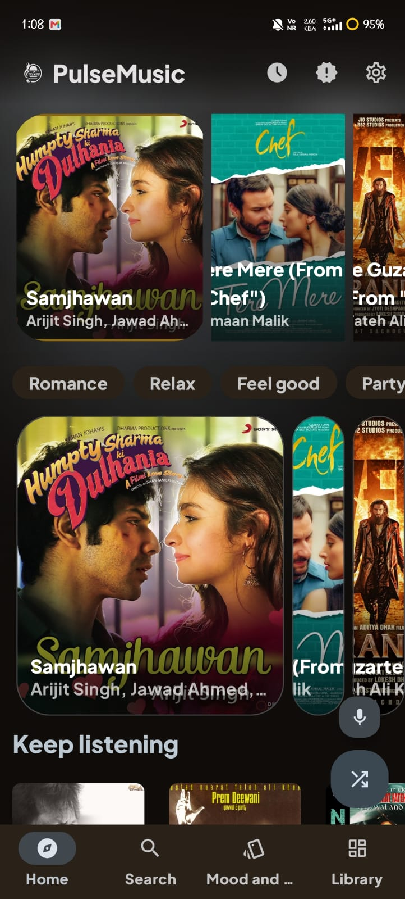
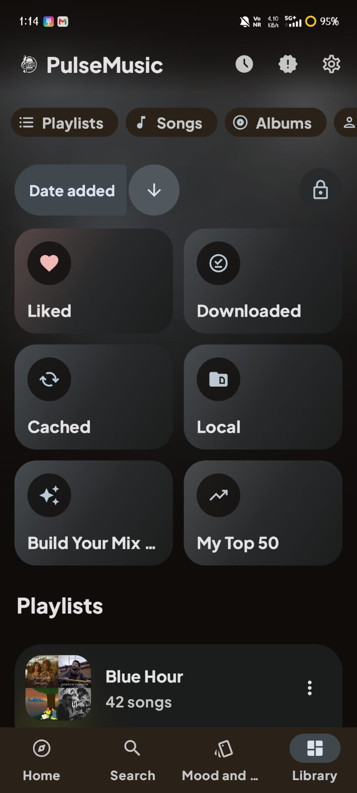
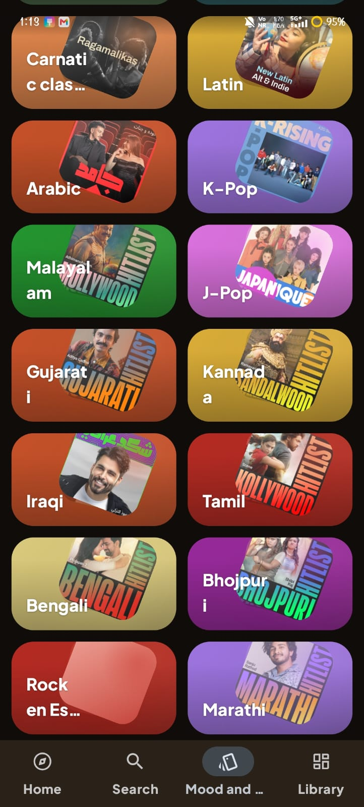
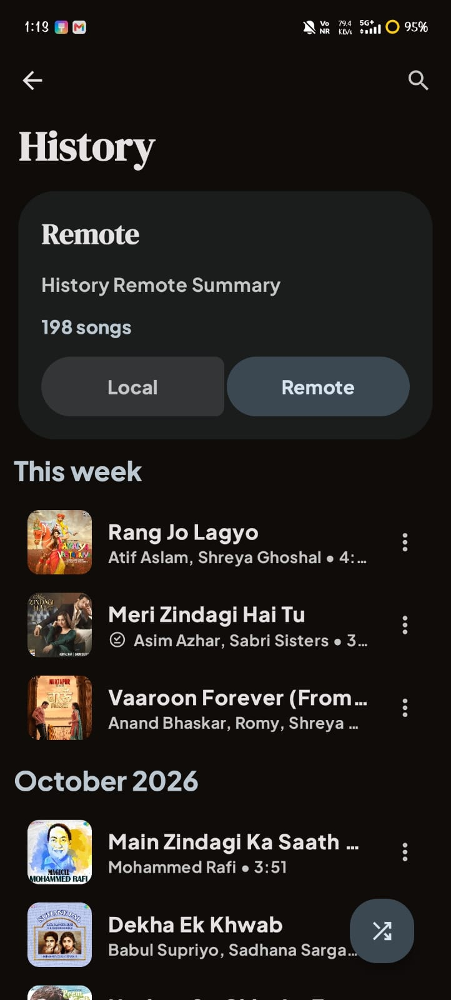
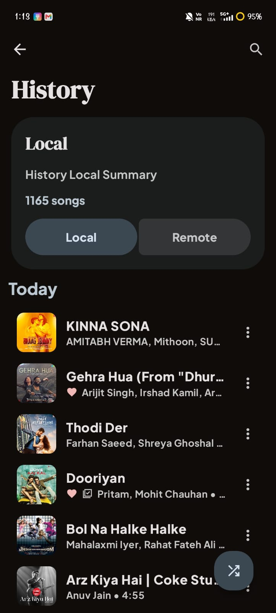
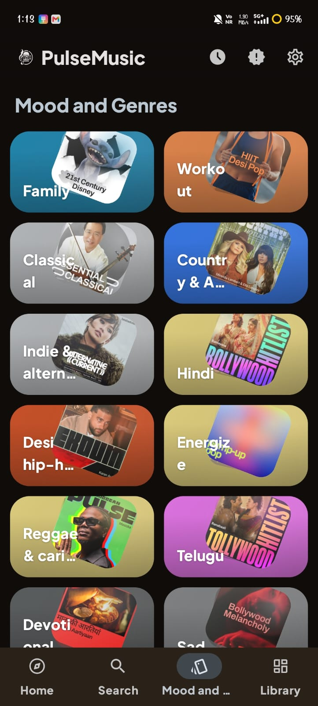

<div align="center">

<table>
  <tr>
    <td align="center" width="300">
      
      <h1>PulseMusic</h1>
    </td>
    <td align="center" width="300">
      
    </td>
  </tr>
</table>


<br/>


<br/><br/>
<b>A modern, highly modular Android music player built with a sleek interface and powerful integrations. PulseMusic brings all your favorite music services and features together into one seamless, unified audio experience.</b>
<br/><br/>
</div>

<div align="center">
  
</div>

<table>
  <tr>
    <td width="75%">
      <h2> Features</h2>
      <ul>
        <li><b>Multi-Source Streaming</b> — Seamless playback integrating Spotify Core and YouTube (InnerTube).</li>
        <li><b>Advanced Lyrics</b> — Real-time synced lyrics powered by BetterLyrics, LrcLib, and Kugou.</li>
        <li><b>Music Recognition</b> — Identify songs playing around you instantly with the built-in ShazamKit module.</li>
        <li><b>Scrobbling</b> — Automatic track tracking through Last.fm integration.</li>
        <li><b>Canvas & Visuals</b> — Dynamic UI that responds to the music, including custom Turntable widgets.</li>
        <li><b>Modular Architecture</b> — Built from the ground up to be scalable, maintainable, and highly decoupled.</li>
      </ul>
    </td>
    <td width="25%" align="center">
      
    </td>
  </tr>
</table>

<div align="center">
  
</div>

##  App Gallery

<div align="center">
  <table>
    <tr>
      <td></td>
      <td></td>
      <td></td>
    </tr>
    <tr>
      <td></td>
      <td></td>
      <td></td>
    </tr>
  </table>
</div>

<div align="center">
  
</div>

##  Modular Structure

PulseMusic is designed using a multi-module architecture to separate concerns and speed up compilation:

* **`:app`** — The main application entry point and presentation layer.
* **`:betterlyrics` & `:lrclib`** — Core components for fetching and parsing lyrics.
* **`:innertube`** — YouTube music integration and streaming layer.
* **`:spotifycore`** — Handling interactions with the Spotify platform.
* **`:lastfm`** — Last.fm account connection and scrobbling.
* **`:shazamkit`** — Audio recognition engine.
* **`:canvas`** — Immersive background and album art rendering.
* **`:kugou`, `:paxsenix`, `:simpmusic`, `:unison`** — Extended plugins and service providers for the ultimate listening experience.

<div align="center">
  
</div>

##  Getting Started

To build the project locally, clone the repository and build via Android Studio or Gradle:

```bash
git clone https://github.com/yourusername/PulseMusic.git
cd PulseMusic
./gradlew assembleDebug
```

<div align="center">
  <br/>
  
  
</div>